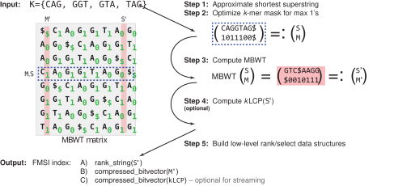

# FMSI

[](https://anaconda.org/bioconda/fmsi)
[](https://github.com/OndrejSladky/fmsi/actions/)

<!-- vim-markdown-toc GFM -->

* [Introduction](#introduction)
* [Installation](#installation)
* [Quick start](#quick-start)
* [Usage](#usage)
   * [Membership and dictionary queries](#membership-and-dictionary-queries)
   * [Presets](#presets)
   * [Streamed queries and the kLCP array](#streamed-queries-and-the-klcp-array)
   * [Threads](#threads)
   * [The type of the mask: min-one and max-one](#the-type-of-the-mask-min-one-and-max-one)
   * [The index file](#the-index-file)
   * [Commands overview](#commands-overview)
* [C++ API](#c-api)
* [FMSI 0.4: legacy commands and set operations](#fmsi-04-legacy-commands-and-set-operations)
* [How it works?](#how-it-works)
* [Testing](#testing)
* [Issues](#issues)
* [Changelog](#changelog)
* [Licence](#licence)
* [Citation](#citation)
* [Contact](#contact)

<!-- vim-markdown-toc -->

## Introduction

FMSI is a memory-efficient index of *k*-mer sets. It represents a set by a
[masked superstring](https://doi.org/10.1101/2023.02.01.526717) (a superstring of the *k*-mers with a mask that tells
which of its *k*-mers are in the set, computed e.g. by [KmerCamel🐫](https://github.com/OndrejSladky/kmercamel)) and
indexes it by its masked Burrows–Wheeler transform, an FM-index without a sampled suffix array. Masked superstrings
stay compact for any *k*-mer set, also for subsampled sets and sequencing data, whose de Bruijn graphs are fragmented.

**FMSI 2** is the same index with a new engine: rank structures that read one cache line, searches of many *k*-mers
in lockstep with prefetching, streaming without an additional array, threads for queries and construction, and
one index file. It answers the queries of FMSI with the same results, one to two orders of magnitude faster:

- **membership queries**: is a *k*-mer in the set? (`fmsi query`)
- **dictionary queries**: the hash of a *k*-mer, a minimal perfect hash of the set (`fmsi lookup`), and the *k*-mer of
  a hash (`fmsi access`)

An index takes 2 bits per character of the superstring plus its mask, i.e. typically 2.3–6 bits per *k*-mer on
disk (1.0–2.1 characters per *k*-mer, depending on the set), and about as much in memory in its most compact layout.

The methods are described in:

[1] Ondřej Sladký, Pavel Veselý, and Karel Břinda: FroM Superstring to Indexing: a space-efficient index for unconstrained *k*-mer sets using the Masked Burrows-Wheeler Transform (MBWT).
*bioRxiv* 2024.10.30.621029; [doi: 10.1101/2024.10.30.621029](https://doi.org/10.1101/2024.10.30.621029).

[2] Ondřej Sladký, Pavel Veselý, and Karel Břinda: Towards Efficient *k*-Mer Set Operations via Function-Assigned Masked Superstrings.
*bioRxiv* 2024.03.06.583483, 2024. [https://doi.org/10.1101/2024.03.06.583483](https://doi.org/10.1101/2024.03.06.583483)

[3] Ondřej Sladký, Pavel Veselý, and Karel Břinda: Masked superstrings as a unified framework for textual *k*-mer set representations. *bioRxiv* 2023.02.01.526717, 2023.
[https://doi.org/10.1101/2023.02.01.526717](https://doi.org/10.1101/2023.02.01.526717)



## Installation

**Prerequisites:** a C++17 compiler (GCC or clang), zlib, CMake (for the bundled sdsl-lite). OpenMP is optional:
with it, the suffix array is constructed on several threads.

```
git clone --recursive https://github.com/OndrejSladky/fmsi
cd fmsi && make -j
export PATH="$PATH:$(pwd)"
```

FMSI 0.4 is on [bioconda](https://bioconda.github.io/) (`conda install bioconda::fmsi`); FMSI 2 is not released there yet.

Notes on compiling:

- The code is compiled with `-march=native` (`make ARCH=...` changes it). The fast code paths need NEON on ARM
  (always there) or POPCNT and SSE4.1 on x86-64 (`ARCH=x86-64-v2` or later; BMI2 is used if available); other targets
  run portable code, which is correct but slower.
- OpenMP: GCC and LLVM clang take `-fopenmp` as they are. Apple clang has no OpenMP runtime: install the one of
  Homebrew (`brew install libomp`), which `make` then finds, or compile everything with the GCC of Homebrew
  (`make CC=gcc-16 CXX=g++-16` from a clean checkout). `make OPENMP=0` switches OpenMP off; `make` prints which it is.

## Quick start

```
# 1. A masked superstring of the 31-mers of your sequences, by KmerCamel
kmercamel compute -k 31 -o ms.fa yourfile.fa

# 2. The index: one file, ms.fa.fmsi
fmsi index ms.fa

# 3. Queries: for every sequence of queries.fa, a line with its name and one 0/1 per k-mer
fmsi query -q queries.fa ms.fa.fmsi

# The same for reads, streamed and on 8 threads
fmsi query -S -t 8 -q reads.fq.gz ms.fa.fmsi

# The hashes of the k-mers (a minimal perfect hash; -1 for a k-mer that is not in the set), and back
fmsi lookup -q queries.fa ms.fa.fmsi
fmsi access -q hashes.txt ms.fa.fmsi

# What the index file holds
fmsi info ms.fa.fmsi
```

## Usage

### Membership and dictionary queries

`fmsi query [-S] [-t INT] -q <queries> <index.fmsi>` answers **membership** queries. The queries are FASTA or FASTQ,
possibly gzipped (`-` or no `-q`: standard input). For each sequence, FMSI prints its name, a tabulator, and one
character per *k*-mer of the sequence: `1` if the *k*-mer is in the set, `0` if not. A *k*-mer and its reverse
complement are the same *k*-mer. *K*-mers with characters other than ACGT are not in the set.

`fmsi lookup` answers **dictionary** queries with the same options: instead of `0`/`1` it prints the comma-separated
hashes of the *k*-mers, `-1` for a *k*-mer that is not in the set. With a min-one mask (the default of KmerCamel; see
[below](#the-type-of-the-mask-min-one-and-max-one)) the hashes are a minimal perfect hash: the *k*-mers of the set get the
numbers 0 to *N* − 1. `fmsi access -q <hashes> <index.fmsi>` is the inverse: for each hash (one per line) it prints
the *k*-mer, as it occurs in the superstring (the looked-up *k*-mer or its reverse complement), and `-` for a value
that is not a hash.

*K*-mers are searched 32 at a time, each step of a search prefetching the memory of the next one (`-b INT` changes
the number; `-b 1` searches one at a time and is several times slower on a large index).

### Presets

`fmsi index` has three presets. The index file holds the BWT and the mask in a compact form of its own; the layout
in memory is built when the index is loaded, so `--extra-small` and `--small` write the same index and differ only
in the layout that the file recommends, which `fmsi query --extra-small` and `--small` override at any time.

| preset | indexed | layout in memory | when |
|---|---|---|---|
| `--extra-small` | the masked superstring | the most compact: BWT in blocks of 256 bytes, Tunstall-coded mask | memory first: about the memory of FMSI 0.4; queries about 1.5 times slower than `--small` |
| `--small` (default) | the masked superstring | the fastest: BWT in blocks of 64 bytes (one cache line per rank), plain mask | the default: about a sixth more memory than `--extra-small` |
| `--fast` | the masked superstring and its reverse complement | the fastest | speed first: twice the size; a *k*-mer is searched as it is only, never as its reverse complement, which about halves the query time |

The options `-c INT` (bytes per block of the BWT: 64, 128 or 256) and `-m STR` (mask: `plain`, `packed`, `rrr`) of
`fmsi index` and `fmsi query` choose a layout in between.

In an index of both strands (`--fast`), the hashes are those of the *k*-mers as they are: a *k*-mer and its reverse
complement have different hashes, in the range 0 to 2*N* − 1.

### Streamed queries and the kLCP array

With `-S`, the *k*-mers of a sequence are streamed: the search of a *k*-mer continues that of its neighbour instead
of starting anew. Use it for reads and longer sequences. It needs nothing beyond the index: the match of a *k*-mer is
extended by the next character and may grow longer than *k*; when it cannot be extended, the *k*-mers that contain
the missing substring are known to be absent and are skipped.

`fmsi index -l` also writes the kLCP array (`<index file>.klcp`), which `-S` then uses (`-L` ignores it). With it,
a match is cut back to *k* − 1 characters before it is extended, so consecutive *k*-mers of a query need not be
consecutive in the superstring. This pays off where reads rarely follow the superstring, e.g. RNA-seq reads on a
transcriptome index; elsewhere streaming without it is about as fast.

### Threads

`fmsi query -t INT` searches on several threads, as the pipeline of minimap2 does: one thread reads the query file
and cuts it into blocks of whole sequences, the searching threads parse and search the blocks, and one thread prints
the results in the order of the input. A sequence is never split, so a long one is searched by one thread.

`fmsi index -t INT` constructs the index on several threads (the suffix array by
[libsais](https://github.com/IlyaGrebnov/libsais), if FMSI is compiled with OpenMP). The index file does not depend
on the number of threads. Construction takes about 5–11 bytes of memory per character of the indexed text
(9 or more beyond 2³¹ characters, where the suffix array has 64-bit integers); `--lean` with `--fast` merges the
suffix arrays of the two strands instead of constructing that of both, which takes less memory and gives the same index.

### The type of the mask: min-one and max-one

A *k*-mer may occur several times in a superstring, and its mask may set one or more of its occurrences:

- a **min-one** mask sets exactly one occurrence of each *k*-mer of the set. Then the number of set bits before the
  occurrence is a minimal perfect hash of the set, which is what `fmsi lookup` returns. KmerCamel writes min-one masks
  by default.
- a **max-one** mask sets all occurrences of the *k*-mers of the set. FMSI 0.4 answers membership queries the fastest
  on such a mask (`-O`: the first bit of the suffix-array interval of a *k*-mer decides).

FMSI 2 tests any mask in constant time, so **one index of a min-one masked superstring serves both membership and
dictionary queries**; `-O` is accepted and ignored. With a mask that is not min-one, `fmsi lookup` still returns
unique hashes, but a *k*-mer set several times has several and the hashes exceed the number of *k*-mers; `fmsi lookup`
says so.

The index file records the type of its mask (`fmsi info`: `mask_type`, `mask_type_source`): as stated with
`fmsi index -M min-one|max-one`, or in the FASTA header of the masked superstring (`mask=min-one`, as KmerCamel
writes), or as computed during construction. A stated type is checked against the computed one and replaced, with a
warning, if the mask contradicts it. The computation is exact for an index of both strands; for one strand it cannot
relate a *k*-mer to its reverse complement (a mask that sets a *k*-mer once in each orientation looks min-one), which
masks of KmerCamel in its bidirectional mode never do.

### The index file

An index is one file, `<name>.fmsi` (default name: that of the masked superstring with `.fmsi` added), and
optionally its kLCP array, `<name>.fmsi.klcp`. `fmsi info <name>.fmsi` prints what it holds: *k*, the number of
strands, the preset, the type of the mask, the recommended layout, the FASTA header of the masked superstring, and the
sections of the file with their sizes; `--check` verifies their checksums.

The file is a container of tagged sections with their table at its end (described in `src/index_file.h`): `META`
(text, `key=value` per line), `BWT` (2 bits per character) and `MASK` (compressed). A reader skips sections that it
does not know unless they are marked as required, so later versions can add data without breaking the files that
exist. The rank structures, the table of the first search steps and the hints of select are not stored: they are
built when the file is loaded, in the layout asked for, which takes about a second per 500 million characters.

`fmsi index --compact-file` (`-z`) stores the mask along the superstring instead of in the order of the suffix
array. There it is a few long runs (the *k*-mers of a simplitig are set, those spanning the junction to the next one
are not), so it takes 0.02–0.35 bits per character instead of 0.2–0.9: the file gets 10–25% smaller. The index is the
same once loaded: the mask is permuted into the order of the suffix array by walks over the BWT, which takes about
10 ns per character on one thread instead of 2 (`fmsi query -t` loads on several threads). Use it where the size of
the file matters more than the time of loading it.

Indexes of the prototype of FMSI 2 (`<prefix>.fmsi2`) are still read; `fmsi convert` rewrites them. Indexes of
FMSI 0.4 (several files `<prefix>.fmsi.*`) are read by `fmsi legacy` only; index the masked superstring again.

### Commands overview

| command | |
|---|---|
| `fmsi index [--extra-small\|--small\|--fast] [-l] [-z] [-t INT] [-o FILE] <masked superstring>` | index a masked superstring |
| `fmsi query [-S] [-t INT] -q <queries> <index.fmsi>` | membership queries |
| `fmsi lookup [-S] [-t INT] -q <queries> <index.fmsi>` | dictionary queries: hashes of *k*-mers |
| `fmsi access -q <hashes> <index.fmsi>` | dictionary queries: *k*-mers of hashes |
| `fmsi export <index.fmsi>` | print the masked superstring of an index |
| `fmsi info [--check] <index.fmsi>` | what an index file holds |
| `fmsi convert <index>` | rewrite an index of an older format |
| `fmsi legacy <command>` | the commands of FMSI 0.4 |

Each command prints its options with `-h`. The index is the last argument.

## C++ API

`src/fmsi_api.h` is the supported way to use FMSI 2 from another program; `src/example.cpp` is a complete example
(`make -C src example`).

```cpp
#include "fmsi_api.h"

fmsi::Index index = fmsi::Index::load("ms.fa.fmsi");

// Membership
bool present = index.contains(kmer);                            // one k-mer
std::vector<uint8_t> hits = index.contains_all(read);           // every k-mer of a sequence, streamed
index.contains_batch(kmers, count, out);                        // many k-mers, searched in lockstep

// Dictionary
int64_t hash = index.lookup(kmer);                              // -1 if the k-mer is not in the set
std::vector<int64_t> hashes = index.lookup_all(read);
std::string back = index.access(hash);                          // the inverse of lookup

// An index can also be built in memory from a masked superstring, and saved
fmsi::Index built = fmsi::Index::build(masked_superstring, 31);
built.save("kmers.fmsi");
```

The query methods are const and can be called from several threads. The methods for many *k*-mers are several times
faster per *k*-mer than those for one. Everything else in the sources is internal and may change.

## FMSI 0.4: legacy commands and set operations

The commands of FMSI 0.4 are available as `fmsi legacy <command>` (`index`, `query`, `lookup`, `export`, and the
experimental set operations `union`, `inter`, `diff`, `symdiff`, `merge`, `compact`), with their options (`-O`, `-f`)
and their index of several files (`<prefix>.fmsi.*`). They are kept for the set operations in the framework of
[function-assigned masked superstrings](https://doi.org/10.1101/2024.03.06.583483), which FMSI 2 does not implement
yet, and for comparisons.

#### Basic: k-mer set operations managed by FMSI

If you wish to perform set operations or answer membership queries without the
need to understand the details of the $f$-masked superstring framework, FMSI
can manage the details for you.

This can be done in a few simple steps:

1. **Compute a masked superstring.**
   - This can be done by [KmerCamel🐫](https://github.com/OndrejSladky/kmercamel); simply run `kmercamel -c -k 31 -p fasta.fa -o ms.fa` (with appropriate values for `-k` and `-p`).
   - If you obtained the masked superstring in a different way, make sure it minimizes the number of ones; if you're unsure, you can use `kmercamel optimize -c -a zeros -k 31 -p ms_more_ones.fa -o ms.fa`. No need to optimize superstrings directly computed by KmerCamel🐫.
2. **Index the masked superstring** with `fmsi legacy index ms.fa`.
3. **Perform the set operations** you wish with `fmsi legacy [operation] -k 31 -p ms1.fa -p ms2.fa -r ms.fa`. Possible operations (use the names instead of `[operation]`) are:
   - `union` to compute the union.
   - `inter` to compute the intersection
   - `diff` to compute the set difference
   - `symdiff` to compute the symmetric difference
4. **Query the index** with `fmsi legacy query -q query.fa -k 31 ms.fa`.
5. To **get back the underlying masked superstring**, use `fmsi legacy export ms.fa`.

If you use FMSI this way, it ensures that operations in any order and queries to any index are computed correctly,
while keeping the memory usage for queries as low as possible. Furthermore, exported $f$-masked superstrings are always,
or-masked superstrings, which are the default masked superstrings.

The only downside to this approach is that each set operation uses compaction, which is the most time- and memory- consuming
part of the process, which in some use cases might cause slowdowns which are not necessary. If this is your case,
you probably want to stick to the advanced usage, managing the functions and building block methods yourself.

#### Advanced: externally managed k-mer set operations

If you wish to manage the operations yourself, the workflow is quite similar to the basic usage, with the following changes:
- Underlying $f$-MS concatenation can be done with `fmsi legacy merge`. Details on which $f$ should be used is described in Chapter 4 of the [paper](https://doi.org/10.1101/2024.03.06.583483).
- Compaction and change back to the or-masked superstring can be done with `fmsi legacy compact`.
- If you query the index with different function than or, use the `-f` argument. The same applies to compaction.


## How it works?

FMSI builds on the representation of *k*-mer sets via [masked superstrings](https://doi.org/10.1101/2023.02.01.526717),
which is compact for any *k*-mer set: typically 1–1.4 characters per *k*-mer for genomes and pan-genomes, about 2 for
sequencing data.

FMSI indexes the superstring by its Burrows–Wheeler transform without a sampled suffix array, which is the key to its
memory efficiency. Instead, the mask is stored in the order of the suffix array (the SA-transformed mask), so that the
presence of a *k*-mer follows from its suffix-array interval without its coordinates in the superstring.

FMSI 2 keeps this index and changes how it is laid out and searched:

- the BWT is stored as 2-bit characters in blocks of 64 bytes with the rank counts in the middle of each block, so
  that a rank reads one cache line (2.29 bits per character; blocks of 128 or 256 bytes take 2.14 or 2.07);
- the mask is a bit vector with in-line counts (1.03 bits per character) or is compressed by a Tunstall code decoded
  within a cache line (0.3–0.9 bits);
- searches run in lockstep, each step prefetching the cache line of its next step, and start from a table of the
  suffix-array intervals of all short strings;
- a *k*-mer is in the set if its interval has a set mask bit, which is tested in constant time for any mask;
- streaming extends the match of a *k*-mer instead of searching the next one anew, with or without the kLCP array.

On disk, the index takes 2 bits per character of the superstring for the BWT and 0.2–0.9 bits for the compressed
mask; the optional kLCP array takes 0.1–0.5 bits per character compressed and 1 bit in memory.


## Testing

To run the associated tests, simply run `make test`.

## Issues

Please use [GitHub issues](https://github.com/OndrejSladky/fmsi/issues).

## Changelog

See [Releases](https://github.com/OndrejSladky/fmsi/releases).


## Licence

[MIT](https://github.com/OndrejSladky/fmsi/blob/master/LICENSE.txt)

## Citation

> Ondřej Sladký, Pavel Veselý, Karel Břinda:
**"FroM Superstring to Indexing: a space-efficient index for unconstrained *k*-mer sets using the Masked Burrows-Wheeler Transform (MBWT)"**, *bioRxiv* 2024.10.30.621029; [doi: 10.1101/2024.10.30.621029](https://doi.org/10.1101/2024.10.30.621029).

```
@article {Sladky2024.10.30.621029,
	author = {Sladk{\'y}, Ond{\v r}ej and Vesel{\'y}, Pavel and B{\v r}inda, Karel},
	title = {FroM Superstring to Indexing: a space-efficient index for unconstrained k-mer sets using the Masked Burrows-Wheeler Transform (MBWT)},
	elocation-id = {2024.10.30.621029},
	year = {2024},
	doi = {10.1101/2024.10.30.621029},
	publisher = {Cold Spring Harbor Laboratory},
	URL = {https://www.biorxiv.org/content/early/2024/11/03/2024.10.30.621029},
	eprint = {https://www.biorxiv.org/content/early/2024/11/03/2024.10.30.621029.full.pdf},
	journal = {bioRxiv}
}
```

## Contact

[Ondrej Sladky](https://iuuk.mff.cuni.cz/~sladky/) \<ondra.sladky@gmail.com\>\

